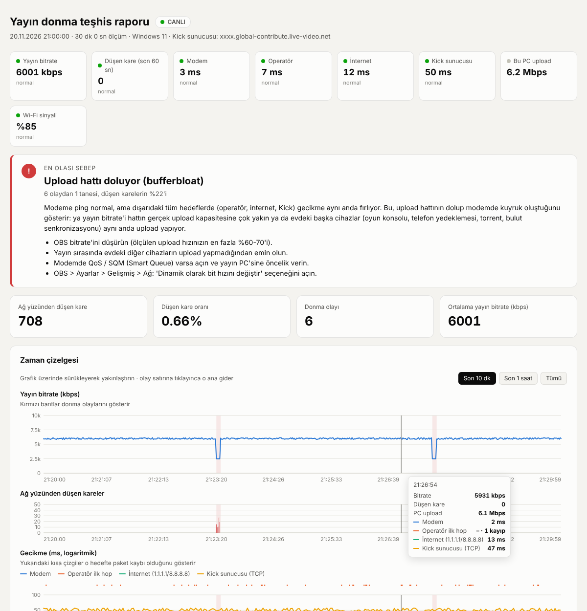

# OBS Stream Doctor

**OBS ile yayın yaparken yaşanan donmaların sebebini bulan, ücretsiz ve açık kaynak bir teşhis aracı.**
Kick (Amazon IVS) için hazırlandı. RTMP/RTMPS kullanan diğer platformlarda da çalışır.

> 🇬🇧 *English summary at the bottom.*



OBS'te "düşen kare" (dropped frames) görüyorsunuz ama sebebini bilmiyor musunuz? Operatör "hattınızda sorun yok" mu diyor?
OBS Stream Doctor yayın sırasında **her saniye** şunları aynı anda ölçer:

| Ölçüm | Nereden |
|---|---|
| Ağ yüzünden düşen kareler, bitrate, tıkanıklık, encoder/render gecikmesi | OBS WebSocket |
| Modem (ağ geçidi) gecikmesi ve kaybı | ping |
| Operatörün ilk sunucusu | traceroute ile bulunur, ping |
| Genel internet (1.1.1.1 / 8.8.8.8) | ping |
| Kick yayın sunucusu (Amazon IVS) | TCP 443 bağlantı süresi + ping |
| Bu bilgisayarın upload trafiği | ağ kartı sayaçları |
| Wi-Fi sinyali ve erişim noktası değişimi | `netsh wlan` (Windows) |

Bir donma olduğunda bu ölçümleri o saniyeye göre karşılaştırır ve sorunun **nerede** olduğunu söyler:

| Kare düştüğü anda ne görülüyor | Teşhis |
|---|---|
| Modeme ping'de bile kayıp/gecikme | **Ev içi ağ** (Wi-Fi, kablo, modem) |
| Modem temiz, dışarıdaki her yerde gecikme fırlıyor | **Upload hattı doluyor** (bufferbloat) |
| Operatörün ilk sunucusundan itibaren her yerde kayıp | **Operatör hattı** |
| Her yer temiz, sadece Kick sunucusuna giden yol bozuk | **Operatör → Kick rotası** (peering) |
| Bu bilgisayar yayın dışında upload yapıyor | **Başka program** (OneDrive, Steam…) |
| Ağ temiz, OBS kare atlıyor | **Bilgisayar** (encoder/render) |

## Kurulum (Windows)

1. [**Releases**](../../releases/latest) sayfasından `OBS-Stream-Doctor-Kurulum-x.y.z.exe` dosyasını indirin.
2. Çift tıklayıp kurun. Python veya başka bir şey kurmanız gerekmez, yönetici izni istemez.
   - Dosya imzasız olduğu için Windows **"Windows bilgisayarınızı korudu"** diyebilir: **Ek bilgi → Yine de çalıştır**.
3. OBS'te bir kereliğine: **Araçlar → WebSocket Sunucu Ayarları → "WebSocket sunucusunu etkinleştir"**.

## Kullanım

1. Yayını açmadan önce masaüstündeki **OBS Stream Doctor** simgesine çift tıklayın.
2. Tarayıcıda **canlı panel** açılır (`http://127.0.0.1:8765`). Siyah pencere açık kalsın.
3. Yayını normal yapın. Donma olduğunda panelde ve pencerede sebebi görünür.
4. Yayın bitince siyah pencerede **Ctrl+C**'ye basın. Son rapor açılır.

Raporlar masaüstündeki **OBS Stream Doctor Raporları** klasörüne kaydedilir:

| Dosya | İçerik |
|---|---|
| `rapor.html` | Grafikli teşhis raporu (yayın sırasında her dakika güncellenir) |
| `olcumler.csv` | Saniye saniye ham ölçümler |
| `olaylar.txt` | Her donma olayı ve muhtemel sebebi |
| `traceroute.txt` | Kick sunucusuna giden yol — operatöre şikâyette kullanın |

En doğru sonuç için donmaların sık olduğu saatlerde en az 30–60 dakika ölçüm yapın.

### Otomatik ayarlar
- **OBS WebSocket şifresi ve portu** OBS'in kendi ayar dosyalarından okunur. Bulunamazsa bir kez sorulur ve hatırlanır.
- **Kick sunucu adresi** OBS profilinizdeki yayın ayarlarından okunur. **Yayın anahtarınız (stream key) hiçbir zaman okunmaz.**

### Gizlilik
Tüm ölçümler ve raporlar yalnızca sizin bilgisayarınızda kalır. Program hiçbir yere veri göndermez.
Canlı panel varsayılan olarak yalnızca bu bilgisayardan açılır (`127.0.0.1`).

## Komut satırı (Windows / macOS / Linux)

Python 3.8+ yeterlidir, ek kütüphane gerekmez (`psutil` isteğe bağlıdır, upload ölçümü için).

```bash
python src/obs_stream_doctor.py                        # her şey otomatik
python src/obs_stream_doctor.py --obs-password XYZ     # şifreyi elle ver
python src/obs_stream_doctor.py --ingest rtmps://xxxx.global-contribute.live-video.net:443/app
python src/obs_stream_doctor.py --no-obs               # OBS olmadan sadece ağı ölç
python src/obs_stream_doctor.py --lan                  # canlı paneli aynı Wi-Fi'deki telefondan aç
python src/obs_stream_doctor.py --analyze "OBS Stream Doctor Raporları/2026-11-20_21-00-00/olcumler.csv"
```

`python src/obs_stream_doctor.py --help` tüm seçenekleri listeler.

## Geliştirme

```bash
python -m unittest discover -s tests -v      # testler (ek kütüphane gerekmez)
bash scripts/build_windows_installer.sh      # Windows kurulum dosyası (Linux'ta, NSIS ile)
```

Kurulum dosyası Linux üzerinde üretilir: conda-forge'dan taşınabilir bir Windows Python'u indirilir, ayıklanır ve
NSIS ile paketlenir. GitHub Actions her `v*` etiketi için kurulumu derler, gerçek bir Windows makinede sessizce kurup
test eder ve **Releases**'e ekler.

Katkılar memnuniyetle karşılanır. Hata bildirirken `olcumler.csv` dosyanızı eklemeniz teşhisi kolaylaştırır.

## Nasıl çalışır?

- **OBS**: WebSocket v5 (`GetStreamStatus`, `GetStats`). İstemci standart kütüphaneyle yazılmıştır.
- **Ping**: Windows'ta yönetici izni gerektirmeyen `IcmpSendEcho` API'si, diğer sistemlerde `ping`.
- **Teşhis**: Her hedefin normal gecikmesi (medyan) ve "gürültüsü" (olay dışı kayıp oranı, ör. ICMP'yi kısıtlayan
  yönlendiriciler) hesaplanır. Her donma olayının ±birkaç saniyelik penceresinde hangi hedeflerin normalden saptığına
  bakılır ve yukarıdaki tabloya göre sınıflandırılır.

## Lisans

[MIT](LICENSE)

---

## English summary

**OBS Stream Doctor** finds out *why* your OBS stream drops frames. While you stream, it samples OBS (via WebSocket)
and pings your router, your ISP's first hop, public DNS and the streaming ingest server (Kick / Amazon IVS) every
second. When OBS drops frames, it correlates the moment with those measurements and tells you whether the cause is
your home network, upload saturation (bufferbloat), your ISP line, the ISP→ingest route, other upload traffic on the
PC, or the encoder. A live dashboard runs at `http://127.0.0.1:8765`, and an HTML report, CSV log and traceroutes are
saved locally. The UI is in Turkish. Windows installer (bundled Python, no admin rights) is available on the Releases
page; the script itself runs on any OS with Python 3.8+. MIT licensed.
